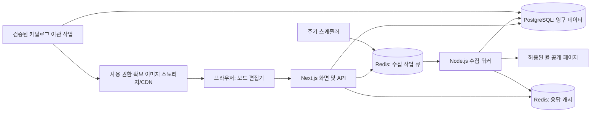

# PedalBook 기술 설계 및 단계별 구현 가이드

> 구현 현황 (2026-10-31): Next.js·TypeScript·React Konva 편집기, 뮬 장터 이동/검색어 복사, 수동 예산까지 구현했습니다. PostgreSQL·Redis·수집 파이프라인은 후속 설계이며 실제 시세 데이터는 아직 공급하지 않습니다. 로컬 JSON v2 계약은 `src/domain/board.ts`, 저장 envelope와 v1 이관은 `src/domain/storage.ts`를 기준으로 합니다. 아래 서버 저장 계약과 자동으로 호환되는 것으로 간주하지 않습니다.


작성 기준: 2026-10-30 · 상태: 제안 설계 · 대상: 1인 풀스택 개발자가 만드는 4주 MVP

> 개발 순서 변경: 먼저 외부 연동 없이 동작하는 페달 배치 편집기와 로컬 저장을 완성한다. 이후 뮬 페이지 연결, 참고 시세·예산, 자동 수집·캐시 순서로 확장한다. 아래 PostgreSQL·Redis·수집 워커 설계는 최종 확장 구조이며 첫 편집기 구현의 선행 조건이 아니다. 최신 우선순위는 [단계별 개발 계획](DEVELOPMENT_PLAN.md)을 따른다.

## 1. 핵심 결정과 확인된 제약

**Next.js + React Konva + PostgreSQL + Redis + 별도 Node.js 수집 워커**를 추천한다. 사용자의 클릭은 DB/캐시를 읽고, 외부 사이트 수집은 워커가 수행한다. 캔버스 렌더링이 외부 사이트의 응답 시간에 묶이지 않도록 한다.

사용자에게 제공할 값은 다음처럼 구분한다.

| 화면 항목 | 정의 |
|---|---|
| 판매 중 매물 | 원문에서 판매 중 상태를 마지막으로 확인한 매물. 확인 시각과 원문 링크를 함께 표시 |
| 현재 매물 호가 | 최근 확인한 유효한 판매 중 매물의 중앙값과 사분위 범위 |
| 최근 등록 호가 | 최근 30일 등록된 유효 매물의 마지막 관측 호가. 완료 매물 포함 여부와 표본 수 표시 |
| 예상 중고 예산 | 배치된 각 페달의 기준 호가 × 구매 필요 수량의 합계 |

판매 완료 표시는 실거래 가격을 증명하지 않는다. 따라서 MVP에 ‘실거래가’라는 표현을 사용하지 않는다. 검색 결과가 전수 매물이 아니라면 ‘수집 범위 내 관측값’이라고 표시한다.

### 1.1 외부 자료 확인 결과

- PedalPlayground는 `public/data/pedals.json`에 `Brand`, `Name`, `Width`, `Height`, `Image`를 제공한다. 기여 안내는 규격이 인치이며 돌출부를 포함하도록 설명한다. 데이터는 색상 변형도 개별 항목으로 가진다. [원본 JSON](https://raw.githubusercontent.com/PedalPlayground/pedalplayground/master/public/data/pedals.json), [기여 안내](https://github.com/PedalPlayground/pedalplayground#contributing)
- 이번 확인에서 명시적인 데이터·이미지 재배포 라이선스는 확인하지 못했다. 공개 저장소라는 이유로 일괄 재배포 허용을 가정하지 않는다. 코드, 데이터, 제조사 이미지의 사용 범위를 각각 확인한다. [GitHub 라이선스 안내](https://docs.github.com/en/repositories/managing-your-repositorys-settings-and-features/customizing-your-repository/licensing-a-repository)
- 뮬의 [중고장터 경로](https://www.mule.co.kr/bbs/market/sell)는 이번 조사 도구에서 403을 반환했다. [robots.txt](https://www.mule.co.kr/robots.txt)도 확인하지 못했다. 검색 파라미터, DOM, 상태 표기, 자동 수집 허용 여부는 **미확인**이다. 이 결과만으로 모든 환경에서 수집 불가능하다고 단정하지 않는다.
- 따라서 뮬 수집 코드는 **검증된 사이트 전용 완제품이 아닌 어댑터 템플릿**이다. 서비스 이용 조건과 접근 범위를 확인하고, 허용된 HTML fixture로 선택자를 확정해야 한다.

이 문서의 TTL, 수집 간격, 표본 기준, 성능 수치는 구현을 시작하기 위한 제안값이다. 뮬이 허용한 수집량이나 보장 성능으로 해석하지 않는다.

## 2. 시스템 아키텍처와 기술 스택



### 2.1 추천 구성

| 계층 | 추천 | 이유 및 역할 |
|---|---|---|
| 프론트엔드 | Next.js App Router + TypeScript | 카탈로그/공유 페이지와 편집기/API를 한 프로젝트에서 개발 |
| 2D 편집기 | Konva + react-konva | React 상태와 페달 객체를 연결하고 드래그/회전 처리 |
| UI/상태 | Tailwind CSS, Zustand, TanStack Query | 편집 상태와 서버 조회 상태 분리. 드래그는 로컬에서 즉시 처리 |
| HTTP API | Next.js Route Handlers | MVP는 별도 API 서버 없이 시작. 수집 워커만 분리 |
| 스키마 검증 | Zod | JSON 좌표/크기/개수, API 입력과 수집 설정 검증 |
| DB | 관리형 PostgreSQL 16 이상 + pg/Drizzle 중 하나 | 정합성, 매물 이력, JSONB 레이아웃. 예제는 pg 사용 |
| 캐시 | Redis | 모델별 매물/통계 결과와 신선도 메타데이터 |
| 비동기 작업 | BullMQ + Node.js 워커 | 중복 수집 억제, 예약 갱신, 실패 복구 |
| 브라우저 수집 | Playwright Chromium | DOM 준비 대기 및 상태 검사. 허용된 정적 응답으로 충분하면 HTTP 파서로 단순화 가능 |
| 이미지 | S3 호환 스토리지 + CDN | 원본 출처와 권한 기록, 썸네일 제공, Canvas export용 CORS |
| 인증 | 관리형 인증 서비스 또는 Auth.js | 인증 subject를 app_users에 매핑. 보드 접근 권한은 API에서 검사 |
| 배포 | 웹 호스팅 + 상시 실행 컨테이너 워커 | 브라우저 작업을 짧은 요청 실행 시간 제한에서 분리 |

Next.js의 서버 컴포넌트는 초기 카탈로그를 제공하고 캔버스는 Client Component로 구성한다. 브라우저 API에 의존하는 코드는 클라이언트 경계 안에 둔다. 채택 버전은 구현 시작일에 호환성을 확인하고 lockfile로 고정한다. [Next.js 공식 안내](https://nextjs.org/docs/app/getting-started/server-and-client-components)

초기에는 모노레포를 다음처럼 구성한다. 이는 예정 구조이며 현재 앱 코드가 생성된 것은 아니다.

```text
apps/web/                  # Next.js, 편집기, 인증, API
apps/worker/               # 뮬 어댑터, 매칭, 집계, 작업 처리
packages/domain/           # 보드 JSON 스키마, mm 좌표, 가격 기준
packages/db/               # SQL migration, 쿼리
packages/catalog/          # 모델/별칭 관리, 이관 작업
docs/                      # 설계, 개발 계획
db/                        # 현재 제공한 초기 DDL 예시
examples/                  # 현재 제공한 이관/수집 예제
```

### 2.2 Konva.js와 Fabric.js 비교

| 기준 | Konva + react-konva | Fabric.js |
|---|---|---|
| React 연결 | JSX 객체와 React 상태 연결이 자연스러움 | 명령형 Canvas 객체와 React 상태의 동기화 설계 필요 |
| 객체 이동·회전 | 드래그와 Transformer 제공. 선택 제어 일부 직접 연결 | 객체 선택, 그룹, 변환 컨트롤 제공 |
| 저장 | 도메인 JSON을 직접 설계해 렌더링 | 객체 직렬화 API 제공. 도메인 데이터는 별도 보관 권장 |
| SVG/텍스트 편집 | 이 서비스에서는 우선순위 낮음 | SVG 입출력, 풍부한 텍스트 편집을 활용하기 좋음 |
| 규격 고정 배치 | 리사이즈를 끄고 이동/회전만 구성하기 적합 | 가능하지만 편집 기능을 제한하는 설정 필요 |
| 직접 구현할 부분 | mm 좌표, 충돌 경고, 스냅, undo/redo, 저장 검증 | 도메인 모델, React 연동, 충돌 경고, 저장 검증 |
| 추천 상황 | 페달 배치 중심의 React 서비스 | 범용 그래픽/SVG 편집기로 확장할 때 |

추천은 Konva다. 물리적 규격이 있는 페달을 배치하는 데 집중하고, 캔버스 내부 직렬화 형식에 저장 포맷이 종속되지 않도록 한다. 공식 Transformer는 노드 연결과 회전을 지원하며 스냅/정렬 등의 제품 기능은 추가 구현이 필요하다. Fabric도 충분히 구현 가능한 대안이다. [Konva Transformer](https://konvajs.org/docs/react/Transformer.html), [Fabric 기능](https://fabricjs.com/), [Fabric 사용자 데이터 지침](https://www.fabricjs.com/docs/using-custom-properties/)

### 2.3 캔버스 좌표 및 저장 원칙

1. **모든 영구 좌표는 mm**로 저장한다. 화면 배율과 devicePixelRatio를 DB 값에 반영하지 않는다.
2. 좌상단이 보드 원점이고, 각 페달은 중심 좌표 `xMm`, `yMm`와 시계 방향 회전각 `rotationDeg`를 저장한다.
3. `screenX = panX + xMm × pixelsPerMm × zoom`이다. 포인터 위치에서 pan/zoom 역변환 후 배치한다.
4. 실제 페달 크기는 고정한다. 회전용 Transformer에 `resizeEnabled={false}`, `flipEnabled={false}`를 적용한다. 기본 회전 스냅은 0/90/180/270도다.
5. 초기 배율은 뷰포트에 보드가 들어오도록 계산한다. UI의 1:1은 물리적 실측 배율을 보장하지 않는다.
6. 회전된 네 꼭짓점으로 보드 밖 여부를 판정한다. 페달 간 겹침 경고는 회전 사각형의 SAT 검사로 구현한다. 경고와 실제 저장 금지는 별도 정책으로 둔다.
7. 잭 돌출부 포함 규격과 케이블 여유 공간을 구분한다. 여유 공간은 옵션으로 시각화하며 원래 규격에 중복 가산하지 않는다.
8. 드래그 종료를 undo/redo 1회로 기록하고 서버 저장은 1초 debounce한다. 저장 실패 시 로컬 초안과 재시도 표시를 유지한다.

DOM 기반 목록·선택 패널에 키보드 이동/90도 회전을 제공한다. Canvas만으로 핵심 조작을 제공하지 않는다.

## 3. PostgreSQL 스키마

완전한 DDL 예시는 [db/001_initial.sql](../db/001_initial.sql)에 있다. `psql "$DATABASE_URL" -v ON_ERROR_STOP=1 -f db/001_initial.sql`로 별도 개발 DB에 적용할 수 있도록 작성했다. 초기 migration이므로 재실행을 전제로 하지 않는다. 관리형 DB의 확장 설치 권한도 확인한다.

### 3.1 핵심 테이블과 확장 테이블

| 테이블 | 주요 필드 | 설계 이유 |
|---|---|---|
| pedals | brand, model_name, variant_name, width_mm, height_mm, image_url, category | 배치용 실물 규격과 출처 보관 |
| mule_listings | pedal_id, title, price_krw, listing_url, sale_status, first_seen_at, last_checked_at | 현재 관측 상태. 게시글 고유 ID로 중복 방지 |
| boards | user_id, width_mm, height_mm, layout JSONB, revision | 소유권 및 저장 충돌 처리 |
| app_users | auth_subject | 인증 시스템과 내부 사용자 ID 연결 |
| pedal_aliases | pedal_id, normalized_alias, kind | ‘보스’, ‘BOSS’, ‘BD-2’ 등 표기 대응 |
| crawl_runs | query_key, status, parser_version, 수집 수·오류 | 정상 빈 결과와 파싱 실패 구별 |
| listing_observations | listing_id, crawl_run_id, price_krw, sale_status | 가격·상태 이력. 재수집을 새 매물로 계산하지 않음 |

금액은 KRW 정수이며 알 수 없는 가격은 NULL이다. 판매 상태 미확인은 `unknown`, 예약은 `reserved`로 구분한다. 최초 수집 시각과 게시 시각은 다르므로 `published_at`을 임의로 현재 시각으로 채우지 않는다.

PostgreSQL의 JSONB는 JSON 연산과 인덱싱을 지원하므로 레이아웃에 적합하다. MVP는 보드 ID/소유자로 조회하므로 큰 layout GIN 인덱스는 우선 만들지 않는다. [PostgreSQL JSON 타입](https://www.postgresql.org/docs/current/datatype-json.html)

DDL 핵심 형태는 다음과 같다. 실제 적용에는 연결된 전체 파일을 사용한다.

```sql
-- pedals의 물리 규격
width_mm numeric(9,3) NOT NULL CHECK (width_mm > 0 AND width_mm <= 5000),
height_mm numeric(9,3) NOT NULL CHECK (height_mm > 0 AND height_mm <= 5000)

-- mule_listings의 중복 방지 및 불명 가격 표현
source_listing_id text NOT NULL UNIQUE,
price_krw bigint CHECK (price_krw > 0),
pedal_id uuid REFERENCES pedals(id)

-- boards의 캔버스 데이터
layout jsonb NOT NULL DEFAULT '{"schemaVersion":1,"items":[]}'::jsonb,
revision integer NOT NULL DEFAULT 1 CHECK (revision > 0)
```

### 3.2 보드 JSON 계약

보드 가로/세로는 `boards` 컬럼을 정본으로 삼고 JSON에 중복 저장하지 않는다.

```json
{
  "schemaVersion": 1,
  "items": [
    {
      "instanceId": "211965d0-c914-4b38-af0d-f5f30e5dffaf",
      "pedalId": "c239d4ea-570a-435a-bfe1-ae035c5cb1c3",
      "xMm": 100,
      "yMm": 80,
      "rotationDeg": 90,
      "zIndex": 0,
      "owned": false,
      "dimensionSnapshot": { "widthMm": 73, "heightMm": 129 }
    }
  ]
}
```

`instanceId`는 같은 모델을 두 개 올렸을 때도 다르다. `pedalId`가 모델/외형을 식별한다. `dimensionSnapshot`은 저장 후 카탈로그 규격 변경으로 기존 배치가 달라지는 것을 막는다. 서버가 카탈로그를 기준으로 생성·검증하고 규격 업데이트 적용은 사용자가 선택하게 한다.

JSONB 안의 pedalId는 일반 FK로 검증되지 않는다. API에서 존재하는 활성 페달인지 확인하고, `instanceId` 중복, 유한한 좌표, 각도 범위, 최대 100개 항목, 요청 본문 256KB 제한을 검사한다. DB는 JSON 구조의 최소 조건만 검사한다. 보존할 카탈로그는 물리 삭제 대신 `is_active=false`로 관리한다.

저장 시 클라이언트가 읽은 revision을 보내며 다음 UPDATE의 반환 행이 없으면 409를 응답한다.

```sql
UPDATE boards
SET layout = $1::jsonb, revision = revision + 1
WHERE id = $2 AND user_id = $3 AND revision = $4
RETURNING revision;
```

소유자 ID는 인증 세션에서 얻는다. 요청 JSON의 userId를 신뢰하지 않는다. 서버 DB 계정을 브라우저에 노출하지 않고, 직접 DB 접근을 제공한다면 별도 RLS를 추가한다.

### 3.3 외형과 시장 모델의 분리

초기 데이터는 원본 `Name`을 보존한다. 괄호를 일괄 제거하면 버전·미니·한정판을 잘못 합칠 수 있다. MVP는 검수된 대표 외형만 가격과 연결하고, 별칭 사전에 브랜드/한글/모델명을 등록한다. 불확실한 색상 변형은 가격을 공유하지 않는다.

카탈로그가 커지면 `pedal_models`(시장 모델/세대), `pedal_variants`(외형/색상/이미지/규격)로 분리한다. boards는 variant, 매물은 model에 연결하고 한정판은 별도 가격군을 유지한다. 이 구조 변경 전에도 안정적인 UUID와 매핑표를 보존한다.

## 4. PedalPlayground 데이터 이관 파이프라인

### 4.1 수집·검증·적재 절차

1. 사용 범위를 확인하고 고정 commit SHA와 파일 해시를 수집 manifest에 기록한다. 가변 master를 매 실행마다 직접 운영 DB로 반영하지 않는다.
2. 해당 revision의 `public/data/pedals.json`과 필요한 이미지 목록을 staging으로 가져온다. 이미지 재배포가 미확정이면 파일명/출처만 보존하고 서비스에는 직접 확보한 이미지 또는 실측 사각형을 쓴다.
3. 필수 필드, 양수 규격, 중복 키, 유효한 이미지 경로를 전체 검증한다. 잘못된 행은 오류 보고서와 함께 격리하거나 전체 배치를 실패시킨다.
4. 인치를 mm로 변환한다: `width_mm = Width × 25.4`, `height_mm = Height × 25.4`. 저장 정밀도는 0.001mm지만 실제 측정 정확도가 그 수준이라는 뜻은 아니다.
5. 원본 이미지명 기반 source_key와 이전 실행을 비교한다. 새 항목, 파일명 변경, 규격 변경, 삭제 후보를 검수한다.
6. staging에서 승인된 변경만 transaction upsert한다. 원본 payload를 남기고 기존 UUID를 유지한다.
7. 사용 권한을 확보한 이미지만 WebP/PNG 썸네일로 변환하고 콘텐츠 해시 경로에 업로드한다. image_url은 내 CDN URL로 설정한다. 외부 raw URL을 운영 이미지로 hotlink하지 않는다.
8. 카테고리와 한글 별칭은 원본에 없으므로 별도 관리한다. 알 수 없는 category는 `unknown`이다.
9. 이후 주 1회 변경 여부를 확인하고 승인 diff만 반영한다. upstream 삭제는 내 데이터의 즉시 삭제로 전파하지 않는다.

원본 데이터의 실제 필드 형식에 맞춘 DB 적재 예제는 [examples/import-pedals.mjs](../examples/import-pedals.mjs)에 있다. 주요 변환은 다음과 같다.

```js
const widthMm = (source.Width * 25.4).toFixed(3);
const heightMm = (source.Height * 25.4).toFixed(3);
// brand <- Brand, model_name <- Name, source_key <- Image
// source_revision <- 검토한 40자리 commit SHA
```

예제는 `npm install pg`가 된 별도 예제 환경에서 실행한다.

```sh
node examples/import-pedals.mjs /path/to/pedals.json <40자리_commit_SHA>
```

접속 정보는 환경변수 `DATABASE_URL`로 주입한다. 예제는 전체 행 검증 후 transaction으로 적재하며 재실행 시 동일 source key에 upsert한다. 이름·카테고리·검수 정보는 업데이트 시 덮어쓰지 않고 원본 payload만 갱신한다. **이미지 다운로드, 권한 자동 판단, 모델 병합, 삭제 동기화까지 구현된 예제는 아니다.**

이미지명은 영구 ID가 아니므로 upstream 파일명 변경을 검수 없이 신규 페달로 확정하지 않는다. 대규모 적재는 임시 staging 테이블에 COPY한 뒤 일괄 upsert하는 방식으로 발전시킨다.

## 5. 뮬 수집 및 모델 매칭

### 5.1 접근 정책과 수집 범위

수집 방식 확정 전 이용 조건, robots, 운영자 제공 API/제휴 여부를 확인한다. 허용된 공개 범위의 제목·가격·상태·게시 시각·원문 링크만 우선 처리한다. 판매자 연락처, 계정 식별자, 본문 전체, 원문 사진을 제품 요구 없이 수집하지 않는다.

요청한 ‘IP 차단 방지 딜레이’는 **부하 제한과 차단 신호에 대한 중단**으로 설계한다. 정직한 서비스명/연락처 User-Agent를 쓰고, UA 위장·프록시 회전·CAPTCHA 우회에 의존하지 않는다. 딜레이는 수집 허가나 비차단을 보장하지 않는다.

| 항목 | 초기 제안 |
|---|---|
| 호스트 탐색 동시성 | 전체 워커 합산 1 |
| 탐색 요청 간격 | 최소 5초 + 0~3초 jitter. 승인 범위가 더 엄격하면 그 범위 적용 |
| 검색 범위 | 검수된 모델/별칭, 최근순, 작업당 최대 3페이지 예산 |
| 상세 접근 | 신규/변경 후보 중 꼭 필요한 건만, 같은 limiter 적용 |
| 401/403/CAPTCHA | 호스트 큐 중단, 운영 검토 전 자동 재개하지 않음 |
| 429 | Retry-After까지 전체 호스트 냉각. 미제공 시 예: 1시간 후 1회 확인 |
| 일시적 5xx/timeout | 최대 2회 재시도, 1분/5분 backoff. 총 작업 시간 상한 적용 |
| 파서 이상 | 쓰기/캐시 게시 중단. 마지막 정상 데이터는 유지 |

브라우저 1회 탐색에는 하위 리소스 요청이 포함된다. 위 간격은 탐색 기준이고 총 요청량·대역폭도 관측해야 한다. 허용된 동작에 영향이 없다면 이미지·폰트 로딩을 줄이되 페이지 기능과 상태 표시는 검증한다.

### 5.2 수집 흐름

```text
검수된 pedalId → 승인된 검색어/별칭 생성
→ 큐 중복 억제 → 호스트 요청 예산 확보
→ 확인된 검색 URL 생성 → 페이지 탐색 및 상태 확인
→ DOM readiness/빈 결과/차단 표식 판정
→ 제목·가격 셀·상태·원문 ID 추출
→ 정규화 → 모델 매칭 → 노이즈 격리
→ 게시글 ID upsert + 관측 이력 저장
→ 영향받은 모델 통계 재계산 → 캐시 게시
```

검색 URL은 `URL`/`URLSearchParams`로 구성하되 실제 뮬 파라미터를 확인한 뒤 구현한다. 이 문서는 확인하지 않은 파라미터나 CSS 선택자를 사실로 제시하지 않는다. 판매 중 필터가 있더라도 상태를 재검증하고 필터 결과 자체를 진실로 가정하지 않는다.

### 5.3 노이즈 필터와 매칭 기준

- 문자열은 Unicode NFKC, 영문 소문자, 공백·하이픈 정규화를 적용한다. `BD-2`와 `BD2`를 연결하되 `DD-3`와 `DD-3T`, `V1`과 `V2`, Mini 등 구분 토큰을 유지한다.
- 브랜드 별칭 + 정확 모델 토큰 + 세대/변형 토큰으로 후보 점수를 계산한다. `boss` 없이 `ds1`만 나온 경우처럼 근거가 약하면 미매칭 후보로 보존한다.
- 구매/삽니다, 교환, 부품·박스·케이스, 고장·수리용, 복제품, 묶음·일괄 판매를 별도 분류한다. 단순 키워드 하나로 제목 전체를 잘못 제외하지 않도록 fixture를 둔다.
- 제목 숫자에서 가격을 추출하지 않는다. 확인된 가격 셀에서만 원화 정수를 읽는다. ‘협의’, ‘교환’, ‘1’, ‘1234’, 모델별로 비현실적인 입력은 검토 대상으로 분리한다. 10만원 같은 단위 표현은 검증된 별도 파서로 처리한다.
- 초기 자동 확정 기준은 보수적으로 예를 들어 confidence ≥ 0.95로 정하고, 0.80~0.95는 검수, 미만은 제외한다. 점수는 통계적 확률이 아니며 라벨셋에서 보정한다.
- 동일 게시글 ID는 한 번만 계산한다. 재등록 의심 건은 모델·제목·가격·시각 유사도로 묶어 검토한다. 판매자 개인정보를 추가 수집해 중복을 해결하지 않는다.
- 가격이 낮다는 이유만으로 삭제하지 않는다. 상태·모델을 우선 확인하고 IQR 필터 전후 표본 수를 기록한다. 원본 행은 보존한다.

목록에서 사라졌다는 이유로 sold로 바꾸지 않는다. 페이지 제한, 검색 순위, 제목 변경일 수 있다. sold는 원문에서 명시적으로 확인한 상태만 사용하고 오래 미확인된 active는 조회/통계에서 제외하거나 ‘확인 필요’로 표시한다. 삭제도 명시적 삭제 응답과 접근 실패를 구분한다.

### 5.4 Playwright 샘플 코드

[examples/collect-mule.mjs](../examples/collect-mule.mjs)는 Node.js Playwright 기반 전체 템플릿이다. 아래 흐름에 더해 URL allowlist, 명시적 빈 결과 검사, 게시글 ID 중복 제거, 보수적 가격 파싱, browser finally 정리를 포함한다.

```js
const context = await browser.newContext({
  userAgent: config.userAgent,
  locale: 'ko-KR',
  timezoneId: 'Asia/Seoul',
});
const response = await page.goto(verifiedSearchUrl, {
  waitUntil: 'domcontentloaded', timeout: 30_000,
});
if ([401, 403, 429].includes(response.status())) {
  throw new Error('SOURCE_BLOCKED');
}
// 검증한 ready/empty/blocked 선택자를 기다린 후 행을 파싱한다.
```

어댑터 설정 계약은 다음과 같다. `<...>`는 실제 HTML을 확인한 값으로 교체해야 하며, 이 상태로는 실행하지 않는다.

```json
{
  "parserVersion": "mule-v1-reviewed-YYYYMMDD",
  "userAgent": "PedalBookBot/0.1 (+https://YOUR-DOMAIN/crawler; YOUR-CONTACT)",
  "searchUrls": ["<검증된 https://www.mule.co.kr 검색 URL>"],
  "listingIdParam": "<검증된 게시글 ID query parameter>",
  "selectors": {
    "ready": "<결과 준비 표식>",
    "row": "<매물 행>",
    "link": "<행 내부 원문 링크>",
    "title": "<행 내부 제목>",
    "price": "<행 내부 가격>",
    "status": "<행 내부 상태>",
    "empty": "<명시적인 검색 결과 없음 표식>",
    "blocked": "<차단/로그인/챌린지 표식>"
  },
  "statusMap": {
    "<정규화한 원문 판매중 표시>": "active",
    "<정규화한 원문 판매완료 표시>": "sold"
  }
}
```

상태 배지가 없다는 사실만으로 active를 추정하지 않는다. 제공된 예제는 query parameter 기반 ID 추출을 가정하므로 실제 ID가 경로에 있으면 어댑터를 변경한다. 검토가 완료된 환경에서 `MULE_COLLECTION_ENABLED=true`, `MULE_ADAPTER_CONFIG=/path/to/reviewed-config.json`을 설정하고 실행한다.

Playwright의 `goto`는 HTTP 오류 응답을 반드시 예외로 던지지 않으므로 응답 상태를 직접 검사한다. [Playwright Page API](https://playwright.dev/docs/api/class-page#page-goto), [BrowserContext API](https://playwright.dev/docs/api/class-browsercontext)

샘플은 최대 3개의 **미리 준비된** 검색 페이지를 방문하며 다음 페이지를 자동 탐색하지 않는다. 출력은 모델 미매칭 후보이며 실제 수집기는 다음 구현을 추가해야 한다.

1. 승인된 URL 빌더 및 상세 페이지 어댑터.
2. Redis 기반 호스트 전체 limiter와 429 냉각, 차단 시 큐 정지.
3. 모델 매칭/노이즈 분류 및 DB 트랜잭션 저장.
4. 성공 run에 한해 통계·캐시 게시. 실패 run은 기존 정상 결과 유지.
5. 중복 run 재처리에도 안전한 source ID upsert와 observation unique key.

## 6. Redis 캐시 및 주기 갱신

### 6.1 키와 TTL

매물 목록과 통계를 하나의 모델별 snapshot에 함께 저장해 집계 시점 차이를 줄인다.

| 키 | 내용 | 초기 정책 |
|---|---|---|
| `market:v1:pedal:{id}` | 페이지용 매물, 호가 통계, 확인 시각, run ID | 논리 신선도 15분, 물리 TTL 24시간 ± jitter |
| `market:v1:empty:{id}` | 정상 실행에서 확인한 빈 결과 | 5분. 수집 실패는 빈 결과로 캐싱하지 않음 |
| `catalog:v1:{queryHash}` | 정규화된 카탈로그 검색 | TTL 24시간, 이관 후 관련 캐시 무효화 |
| `refresh:v1:{pedalId}` | 진행/대기 중 갱신 작업 중복 억제 | 작업 완료/실패와 연계, 처리 시간 상한보다 길게 유지 |
| `source:mule:cooldown` | 호스트 차단/429 냉각 | 상태와 Retry-After에 따라 설정 |

`market` 값에는 `fetchedAt`, `freshUntil`, `staleUntil`, `sourceStatus`, `sampleCount`, `coverage`, `policyVersion`, `listings`, `statistics`를 넣는다. 정상 빈 결과에도 5분의 논리 신선도를 적용한다. 키 존재만으로 fresh라고 판단하지 않는다.

### 6.2 조회 흐름과 stampede 방지

1. 신선한 캐시가 있으면 즉시 200을 반환한다.
2. 신선도가 지났지만 staleUntil 안이면 마지막 정상 값과 stale 표시를 반환하고 단일 갱신 작업을 예약한다.
3. 캐시가 없으면 PostgreSQL에서 최신 정상 snapshot을 재구성한다. 오래된 데이터에는 같은 stale 표시를 적용한다.
4. 정상 데이터가 한 번도 없으면 `202 {status:"pending", ...}`를 반환한다. 외부 사이트 수집이 끝날 때까지 HTTP 요청을 붙들지 않는다.
5. 클라이언트는 pending인 모델만 예: 5초 간격으로 최대 30초 확인한 뒤 ‘수집 대기’로 남긴다. 이후 간격을 늘리고 페이지 이탈 시 polling을 중지한다.
6. 수집 성공 시 DB commit 후 캐시 snapshot을 교체한다. Redis 장애가 발생해도 다음 조회에서 DB로 복구한다.

BullMQ deduplication 또는 별도 lock을 사용하되 수집 실행 중 중복 작업이 쌓이지 않게 한다. 간단한 Redis 락은 `SET key token NX PX duration`으로 획득하고, token이 같을 때만 삭제한다. 락 만료 후 겹친 작업이 쓰기를 경쟁하지 않도록 작업 시간 제한·갱신과 DB 최신 run 비교를 함께 적용한다. 락은 DB 트랜잭션 정합성을 대체하지 않는다. [Redis 락 패턴](https://redis.io/docs/latest/develop/clients/patterns/distributed-locks/)

### 6.3 갱신 주기와 요청 예산

- 최근 24시간 내 조회한 인기 20개 모델: 30~60분 목표.
- 나머지 활성 관심 모델: 6시간~24시간 목표.
- 오래된 전체 카탈로그: 상시 전수 수집하지 않고 수요 기반 갱신.
- 30일 호가 통계: 성공 수집 후 재계산, 1일 1회 보정 배치.
- 기존 active 매물: 관심 모델부터 상세 상태 재확인. 하루 이상 미확인은 기본 ‘현재 매물’ 통계에서 제외.

**목표 주기보다 호스트 요청 예산이 우선**이다. 예를 들어 20모델 × 2페이지 × 시간당 1회 = 하루 960번의 탐색이고, 추가 상세 조회가 있으면 더 늘어난다. 모델 100개를 15분마다 3페이지씩 조회하면 하루 28,800번이므로 초기 MVP에 적용하지 않는다. 승인된 일일 예산에 맞춰 모델 수/페이지 수/주기를 줄이고 큐 지연을 사용자에게 표시한다.

BullMQ limiter는 작업 단위이므로 작업당 여러 `page.goto`가 있다면 HTTP/탐색 단위의 공유 limiter가 추가로 필요하다. 호스트 전체 cooldown은 워커 수에 상관없이 적용한다. [BullMQ rate limiting](https://docs.bullmq.io/guide/rate-limiting)

큐용 Redis는 `noeviction`과 복구 가능한 영속화 설정을 권장한다. 캐시는 LRU 정책이 가능하므로 운영에서는 큐와 캐시 인스턴스를 분리한다. MVP에서 공유하면 메모리 상한·큐 보존 정책을 설정하고 임의 eviction으로 작업 키가 사라지지 않도록 한다.

## 7. 호가 집계 및 총 예산 계산

### 7.1 집계 기준

현재 호가의 유효 표본은 다음을 모두 만족해야 한다.

- 해당 모델로 검수/고신뢰 매칭, 단품 판매, 정상 원화 가격.
- active이며 마지막 상태 확인이 24시간 이내.
- 동일 source listing ID 중복 제거. 재등록 의심 표본은 별도 표시/제외.
- 고장·복제·부품·묶음·구매·교환 등 제외.

최근 30일 등록 호가는 `published_at`이 실제 확인된 매물만 포함하고, 각 게시글당 최신 유효 관측값 하나를 쓴다. 처음 수집했다고 ‘30일 데이터’를 즉시 확보한 것은 아니다. 게시 시각을 읽을 수 없으면 별도의 ‘최근 30일 최초 관측 호가’ 지표로 표시한다.

표본 5개 이상이면 중앙값(P50)과 P25~P75, 2~4개면 ‘표본 적음’과 관측 범위, 1개면 해당 매물 호가, 0개면 정보 없음으로 표시한다. 소표본에 IQR 이상치 제거를 자동 적용하지 않는다. 판매 완료 게시글의 마지막 호가는 참고용 별도 지표이며 현재 매물 중앙값과 혼합하지 않는다.

아래 SQL은 매칭·상태·금액 검증이 끝난 데이터의 현재 호가 집계 예시다. 재등록/노이즈의 추가 정제는 앞선 파이프라인에서 수행한다.

```sql
SELECT pedal_id,
       count(*) AS sample_count,
       percentile_cont(0.25) WITHIN GROUP (ORDER BY price_krw) AS p25,
       percentile_cont(0.50) WITHIN GROUP (ORDER BY price_krw) AS median,
       percentile_cont(0.75) WITHIN GROUP (ORDER BY price_krw) AS p75
FROM mule_listings
WHERE pedal_id IS NOT NULL
  AND sale_status = 'active' AND listing_kind = 'sell'
  AND NOT is_bundle AND price_kind = 'fixed' AND price_krw > 0
  AND (reviewed_at IS NOT NULL OR match_confidence >= 0.95)
  AND last_checked_at >= now() - interval '24 hours'
GROUP BY pedal_id;
```

### 7.2 예산 계산

`예산 = Σ(페달 인스턴스별 기준 단가)`. 같은 모델 두 개는 두 번 합산한다. UI에서는 ‘전체 배치 가치’와 `owned=false`인 ‘추가 구매 예산’을 구분한다.

가격 선택 우선순위는 사용자가 고른 유효 매물 → 신선한 현재 호가 중앙값 → 최근 등록 호가 참고값이다. 참고값을 쓰면 근거를 표시하고 매물이 실제로 존재한다고 표현하지 않는다. 품목별 확인 시각과 통계 정책 버전을 반환한다.

가격 미상 2개가 있으면 ‘확인된 6/8개 합계 680,000원 · 2개 가격 미상’으로 표시한다. 미상 가격을 0원으로 합쳐 완전한 예산처럼 보여주지 않는다. 배송비, 보드 자체, 전원 공급기, 패치 케이블, 수수료는 기본 합계에 포함하지 않으며 포함 항목을 명시한다.

특정 매물 선택은 구매 예약이 아니다. 동일 매물을 보드 내 두 인스턴스에 중복 할당하지 못하게 하고, 같은 모델 두 개의 중앙값 합계는 그 가격에 두 개를 구할 수 있다는 보장이 없는 참고 예산으로 표시한다.

## 8. API 및 사용자 흐름

| API | 책임 |
|---|---|
| `GET /api/pedals?q=&category=&cursor=` | 카탈로그/별칭 검색, 페이지 최대 50개 |
| `GET /api/pedals/:id/market` | 매물 + 호가 snapshot + 신선도/표본 수 |
| `POST /api/boards` | 로그인 소유자의 보드 생성 |
| `GET /api/boards/:id` | 소유자 권한 확인 후 레이아웃 조회 |
| `PATCH /api/boards/:id` | 크기/레이아웃 검증, revision 기반 저장 |
| `POST /api/boards/:id/budget` | 저장된 보드와 모델별 snapshot으로 예산 계산 |

매물 응답 예시의 금액은 설명용 가상 데이터다.

```json
{
  "pedalId": "...",
  "status": "ready",
  "stale": false,
  "fetchedAt": "2026-10-30T06:00:00Z",
  "freshUntil": "2026-10-30T06:15:00Z",
  "coverage": { "pages": 2, "complete": false },
  "statistics": {
    "metric": "active_asking_price", "window": "checked_within_24h",
    "sampleCount": 7, "medianKrw": 120000,
    "p25Krw": 110000, "p75Krw": 130000, "policyVersion": "asking-v1"
  },
  "listings": []
}
```

외부 사이트 차단은 빈 매물과 다르다. `sourceStatus:"blocked"`와 마지막 정상 확인 시각을 제공한다. 사용자가 갱신을 연타해도 인증/요청 제한과 모델별 deduplication으로 동일 작업만 유지한다. private 보드 응답은 공유 캐시에 저장하지 않는다.

사용자 흐름은 ‘보드 규격 선택 → 카탈로그 검색 → 캔버스 배치/회전 → 페달 선택 → 매물·호가 패널 → 예산 확인 → 저장’ 순서다. 뮬 연동이 비활성일 때도 편집·저장·수동 기준 단가 기능으로 사용할 수 있게 한다. 수동 단가는 자동 통계와 명확히 구분한다.

## 9. 운영·보안·품질 기준

- DB/Redis와 외부 접속 비밀은 서버에만 저장한다. DB pool과 worker connection 수 상한을 둔다.
- 보드 생성/수정/예산 조회의 소유권을 모두 검사한다. 쿠키 인증을 사용하면 Origin/CSRF 정책을 검토한다.
- 외부 제목은 텍스트로 렌더링하고 HTML을 삽입하지 않는다. 링크는 https 및 승인 호스트를 검증한다.
- 크롤러는 사용자 입력 URL을 직접 열지 않는다. 승인된 URL 빌더/host allowlist와 배포 egress 제한으로 SSRF를 방지한다.
- 이미지 URL도 승인된 CDN으로 제한한다. 이미지 로딩 실패 시 실측 사각형·텍스트를 제공한다.
- run 성공률, 파싱 행 수 급감, 미매칭률, 403/429, 큐 지연, 캐시 적중률, 통계 표본 수, 오래된 데이터 비율을 관측한다.
- 파서 변경은 버전과 HTML fixture를 함께 갱신한다. 정상 빈 결과, 로그인/차단 화면, 상태 미표시, 묶음 판매를 회귀 검증한다.
- 관측 이력은 초기 180일을 제안하며 허용된 보존 범위 안에서 조정한다. 일별 통계는 필요한 기간만 보존하고 삭제 요구 처리 경로를 마련한다.
- PostgreSQL 정기 백업과 실제 복원 확인, Redis 재시작 후 DB 복구를 검증한다. Redis는 유일한 데이터 저장소로 사용하지 않는다.

### MVP 목표와 검증 범위

성능 목표는 캐시 hit 매물 API p95 300ms 이하, 데스크톱 기준 50개 페달 배치에서 드래그 50fps 이상으로 두고 테스트 환경·기기를 기록한다. 이는 아직 측정한 결과가 아니다.

구현 시 필요한 검증은 mm/px 역변환, 회전 경계, 저장/복원, 타 사용자 보드 접근 거부, 잘못된 매칭 차단, 상태 전이, 가격 변경 이력, stale/빈 결과/차단 구분, 동시 갱신 억제, 부분 실패 시 기존 데이터 보존이다.

현재 제공물은 설계 문서, DDL, 이관/수집 예제와 로컬 SVG 배치 프로토타입이다. 프로토타입은 저장·복원과 배치 조작을 검증하기 위한 별도 구현이며, 이 문서의 Next.js/React Konva 및 서버 아키텍처가 구현된 상태는 아니다. 실제 뮬 DOM, 라이브 수집, 운영 DB migration, 본 구현 성능은 아직 검증 대상이다. 최신 개발 순서와 완료 조건은 [단계별 개발 계획](DEVELOPMENT_PLAN.md)에 정의한다.

## 3D 배치 편집기 (이슈 #11)

- `next/dynamic`의 클라이언트 전용 지연 로딩으로 Three.js 화면을 3D 전환 시에 생성한다. 2D는 React Konva를 사용하며 두 모드 모두 `useBoard`의 동일한 Board 상태를 편집한다.
- 저장 계약은 schemaVersion 2를 유지한다. `widthMm`/`heightMm`은 평면 가로/세로이며 물리 높이와 구분한다. 1 Three.js 단위 = 1mm이고 저장 X/Y를 월드 X/Z에 대응한다: `(xMm - widthMm/2, 0, yMm - heightMm/2)`. 화면상 시계 방향 회전은 월드 Y축의 음수 라디안으로 변환한다. 시점과 배율은 저장 규격과 분리한다.
- 실제 높이는 `src/domain/board-3d.ts`의 별도 검수 매핑이다. [BOSS DS-1](https://www.boss.info/us/products/ds-1/) 59mm, [Strymon blueSky V2](https://www.strymon.net/product/bluesky/) 61mm(2026-11-03 확인). 나머지는 40mm 임시 시각화이며 제품 정보로 저장/내보내지 않는다. 보드 두께 16mm 및 단순 입체 형상도 시각화용이다.
- 페달을 누른 위치의 높이에 평행한 드래그 평면을 두고 raycast 차이를 mm 이동량으로 사용한다. 이를 통해 원근 시점과 클릭 위치에 따른 순간 이동을 막는다. 공통 `clampPosition`으로 회전한 규격의 경계와 5mm 스냅을 적용한다. 드래그 중에는 장면만 갱신하며 놓을 때 `updateItem`을 한 번 실행해 undo/redo와 저장을 공유한다. 클릭만으로는 좌표를 변경하지 않는다.
- 페달 제스처는 capture 단계에서 OrbitControls와 분리한다. pointer capture를 사용하고 pointercancel/lostpointercapture/blur/Escape 시 미확정 이동을 취소한다. 화면 전환/장면 해제 시에도 정리한다. 배경 터치의 회전·두 손가락 확대는 OrbitControls가 담당한다.
- 라이브러리 드롭은 카메라 ray와 보드 평면의 교차점을 mm로 변환한다. 방향키/R/삭제, 선택 목록, 검사 패널은 기존 편집기 동작을 공유한다.
- 사진 경로와 실패 시 대체 일러스트는 기존 출처 정책을 따른다. 사진은 원본 비율을 유지해 윗면에 맞춘다. 모드 종료와 항목 제거 시 geometry/material/texture/controls/observer/listener 및 WebGL context를 해제하고 늦게 끝난 이미지 로딩이 제거된 장면을 갱신하지 않게 한다. 유휴 시 연속 렌더링하지 않는다.
- WebGL 생성 실패·context loss 시 2D 복귀 안내를 표시한다. 높이 미상/공식 값 구분, 보드의 실제 틈·경사 미반영을 사용자에게 표시한다. 형상 간 3D 충돌 판정은 제공하지 않으며 기존 평면 겹침/경계 경고를 사용한다.
- `tests/board-3d.test.ts`는 좌표 왕복·회전 방향, 여러 시점에서의 grab offset, 스냅/회전 경계, v2 저장 왕복, 종횡비별 전체 보기, 미상 높이를 검증한다.

## RockBoard 구조 확장 (이슈 #13)

기본 3D의 16mm 슬래브 대신, 공식 규격으로 선택한 RockBoard 16종에는 별도 메시를 사용한다. 도메인 치수와 출처는 rockboard.ts, 경사 좌표 변환은 board-3d.ts, 천공·접힘·보강대 생성은 rockboard-geometry.ts로 나눈다. Shape의 실제 hole을 ExtrudeGeometry로 천공하여 하부가 보이고, 제조사 공간도면의 구획은 별도 투명 메시로 토글한다. 카메라는 보드 아래까지 회전 가능하다.

기존 기본 보드의 수평 변환을 RockBoard에 한해 worldY = base − localZ × tan(angle) + step, worldZ = localZ로 확장한다. 페달 드래그는 상판 법선에 평행한 평면을 사용하고 역변환으로 mm를 보존한다. MAX의 계단을 가로지르는 페달은 높은 면에서 표시하고 경고한다. 기존 저장 규격을 자동 수정하지 않으며 사용자가 공식 규격을 적용해야 한다. 자세한 도면 우선순위·근사 부분·검증은 [ROCKBOARD_3D.md](ROCKBOARD_3D.md)를 따른다.

## 하부 장착과 높이 (이슈 #15 / PB-016)

- v2 항목에 선택 필드 `mountSide: 'top' | 'bottom'`, `physicalHeightMm: 1..500`을 추가한다. 미지정 면은 상판, 높이는 검수 매핑 또는 기존 임시 40mm다. 기존 v1/v2는 그대로 읽으며 새 저장/내보내기는 장착 면과 높이를 보존한다. 이 필드를 지원하지 않는 구버전 편집기는 하부 배치를 복원하지 못한다.
- MOSKY ISO-10 (`pp-p-468e6a1037b6cf55433c`)의 공식 높이는 32mm다. [MOSKY 제품 페이지](https://www.moskyaudio.com/product/product-19-230.html), 2026-11-04 확인. 기존 평면 규격 스냅샷은 변경하지 않는다. 사용자 높이는 인스턴스별 우선값으로 저장한다.
- 하부 장비의 바닥 원점은 상판 법선 반대 방향으로 `판 두께 + 2mm 부착 여유`만큼 이동한다. 로컬 X축 180° 반전 뒤 평면 회전과 보드 경사를 적용하므로 조작면이 아래로 향한다. MAX 단차에 걸친 장비는 낮은 면 아래에 배치한다. X/Y는 장착 면의 기준 좌표이며 높이 변경으로 이 좌표를 바꾸지 않는다.
- 하부 이동은 명시적 버튼 조작으로만 설정하고 해당 시점으로 전환한다. 아래 시점의 raycast는 하부 장비만 대상으로 하며 앞의 보강대·측판은 선택을 가린다. 2D에서는 상판/하부를 별도 면으로 표시하며 하부 배지와 점선으로 구분한다.
- 겹침/빈자리 계산은 같은 장착 면끼리만 한다. 하부 여유 경고는 실제 회전된 8개 모서리로 계산한 투영 범위를 공식 구획 너비·앞뒤 길이·높이·MAX 단차와 비교한다. 경고는 위치를 강제로 바꾸지 않으며 직접 이동해 해소한다. 도면 재구성의 공차, 장착 부품·잭·케이블까지 검증한 결과는 아니다.
- 보드 변경 시 하부 설정을 보존한다. 구조를 모르는 보드에서도 저장된 하부 장비는 보이고 상판 복귀가 가능하며, 공간 정보 없음 안내를 표시한다. 새 하부 배치도 구조 미확인 안내와 함께 제공한다.


## 전체 창 편집과 하부 표시 (이슈 #17 / PB-017)

- 100dvh 작업 공간 위에 툴바·라이브러리·선택 패널을 겹쳐 표시한다. 패널을 열어도 캔버스 크기는 바뀌지 않아 선택 직후 드래그 좌표가 이동하지 않는다. 라이브러리는 기본 숨김이며 검색 상태를 유지한다. 보드 설정 패널은 제거하고 보드 정보 대화상자와 내 보드 만들기로 분리한다.
- `surfaceView`는 일시적인 표시 상태이며 mm 저장 데이터와 분리한다. 2D는 해당 mountSide만 표시하고, 하부 배치도는 상판과 같은 X/Y 방향을 유지한다. 3D는 카메라 방향을 반영하고 하부 요청 시 아래로 이동한다. 하단 목록 선택은 대상 면으로 전환한다. 새 장비는 상판으로 추가하며 표시도 상판으로 전환한다.
- 3D 보드 반투명은 구조물 재질을 일시적으로 바꾸며 장비·공간 오버레이에는 적용하지 않는다. 반투명일 때 가려진 장비의 선택을 허용하고, 해제하면 원래 재질과 가림 판정을 복구한다.
- `createCustomBoard`는 보드 이름/평면 크기를 검증하고 modelId를 해제하며 기존 항목은 재배치하지 않는다. 저장 v2 계약은 변경하지 않는다. 경계 밖 장비는 기존 경고로 안내한다. 테스트는 하부/높이/가격 보존·저장 왕복·잘못된 크기 거부를 확인한다.


## BOSS 입체 외형과 하부 반전 (이슈 #19 / PB-018)

`boss.ts`는 명시적인 카탈로그 ID로만 검수 모델과 공식 치수를 연결한다. `boss-geometry.ts`는 케이스/조작부/발판/단자의 절차적 메시를 생성하고 브라우저에서 생성한 문자 텍스처를 붙인다. 제조사 사진 파일을 새로 배포하지 않는다. 대상 외 모델은 기존 사진을 얹은 단순 입체로 유지한다. 저장된 규격과 사용자 높이에 맞춰 스케일을 적용하며 저장 스키마는 변경하지 않는다.

하부의 로컬 변환은 `보드 경사 × 평면 회전 × X축 180°`이다. 바닥 y=0이 장착면, 조작면 +Y가 바닥 반대 방향이다. `itemLocalToWorld`와 3D quaternion을 테스트로 대조하여 도면 여유 경고가 표시와 일치하도록 한다. 새 모델은 몸체뿐 아니라 노브/스위치도 raycast 대상으로 선택하며 하나의 인스턴스로 드래그/회전/undo한다. 생성된 geometry/material/texture는 기존 dispose 경로로 해제한다.
